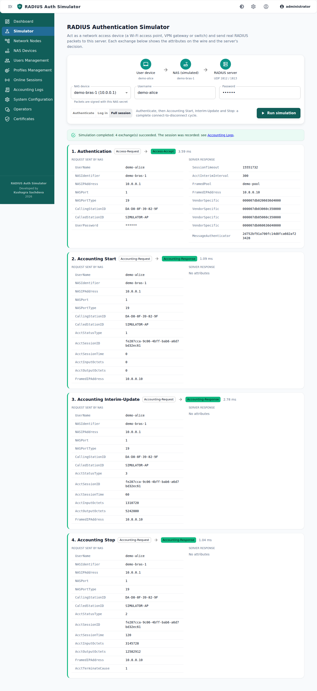
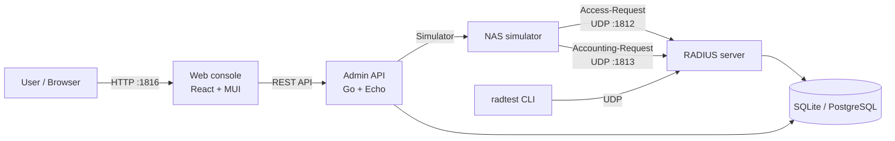
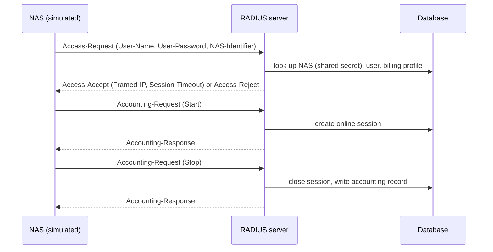
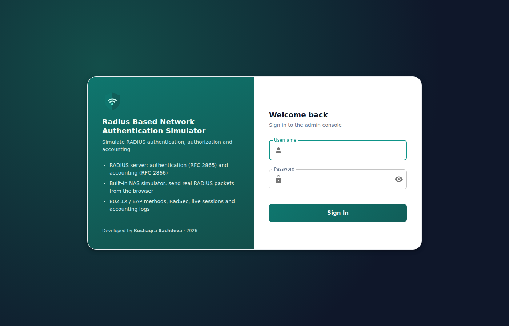
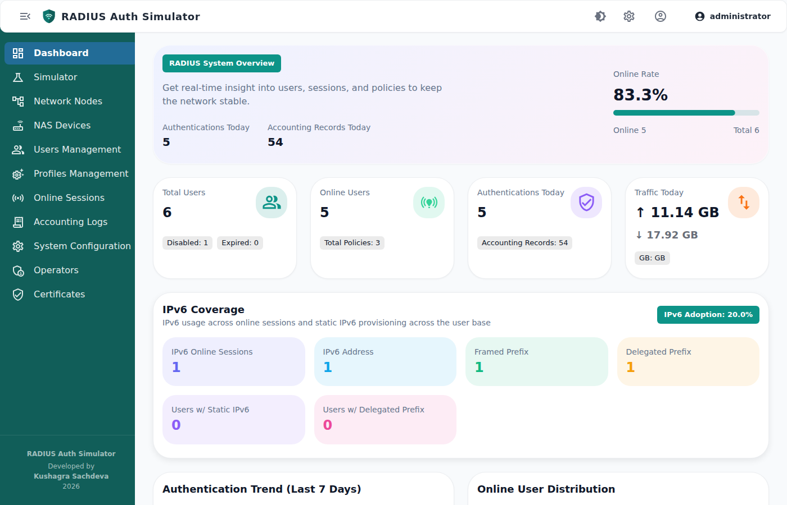

# Radius Based Network Authentication Simulator

**Developed by:** Kushagra Sachdeva

A web-based simulator for **RADIUS** (Remote Authentication Dial-In User Service), the
protocol that Wi-Fi access points, VPN gateways and 802.1X switches use to check a
user's credentials, authorize their session and record their usage (AAA:
Authentication, Authorization, Accounting).

The project runs a complete RADIUS server and adds a **built-in NAS simulator**: from the
browser you act as a network device, send real RADIUS packets to the server, and see
every attribute on the wire together with the server's decision.



---

## 1. Abstract

Network access control in campuses, enterprises and ISPs is built on RADIUS, but the
protocol is hard to observe: the client is a piece of network hardware and the exchange
happens in binary UDP packets. This project provides a self-contained environment in
which RADIUS can be studied end to end. A RADIUS server (RFC 2865/2866) stores users,
billing profiles and network devices in a database; a simulator plays the role of the
Network Access Server (NAS) and drives authentication and accounting exchanges; and a web
console shows the resulting sessions, accounting records and statistics. It runs on
Linux and macOS with no external services, using an embedded SQLite database.

## 2. Objectives

1. Implement the RADIUS authentication and accounting flow between a NAS and a server.
2. Let a user simulate device logins without real network hardware.
3. Visualize each packet exchange: request attributes, response code, reply attributes
   and round-trip time.
4. Manage users, billing profiles (bandwidth, session limits, address pools) and NAS devices
   from a web console.
5. Track online sessions and accounting records produced by the simulations.
6. Run on both Linux and macOS (Apple Silicon and Intel).

## 3. Features

- **RADIUS server**: Access-Request / Accept / Reject (RFC 2865), Accounting Start /
  Interim-Update / Stop (RFC 2866), Change of Authorization and Disconnect (RFC 5176).
- **NAS simulator page** with three modes:
  - *Authenticate*: one Access-Request.
  - *Log in*: authenticate and start accounting, so the user appears in Online Sessions.
  - *Full session*: authenticate, start, interim update and stop.
- **802.1X / EAP**: EAP-MD5, EAP-MSCHAPv2, EAP-TLS, PEAP, EAP-TTLS.
- **RadSec**: RADIUS over TLS (RFC 6614).
- **Web console**: dashboard, users, billing profiles, NAS devices, network nodes, online
  sessions, accounting logs, operators and system settings.
- **Command-line client** `radtest` for scripted tests.
- **Demo data** generator so the system can be explored immediately.

## 4. System Architecture



**Authentication flow (one simulation run):**



## 5. Technology Stack

| Layer | Technology |
| --- | --- |
| RADIUS server and API | Go 1.26, Echo, GORM, layeh/radius |
| Database | SQLite (embedded, default) or PostgreSQL |
| Web console | React 19, TypeScript, React Admin, Material UI, ECharts |
| Build | Make, Vite |
| Testing | Go `testing` + testify, GitHub Actions (Linux and macOS) |

## 6. Modules

| Module | Path | Purpose |
| --- | --- | --- |
| RADIUS service | `internal/radiusd/` | Auth/acct packet handling, EAP, RadSec, vendor attributes |
| Admin API | `internal/adminapi/` | REST endpoints for the console, including `simulator.go` |
| Domain models | `internal/domain/` | Users, profiles, NAS devices, sessions, accounting |
| Web console | `web/src/` | React pages; the simulator is `pages/SimulatorPage.tsx` |
| CLI tools | `cmd/radtest`, `cmd/demo-seed` | Command-line RADIUS client, demo data generator |
| Configuration | `config/` | YAML and environment configuration, per-OS defaults |

## 7. Getting Started

### Requirements

- Go 1.26+ and Node.js 18+
- macOS: `brew install go node`

### Linux / WSL

```bash
git clone https://github.com/Helixo613/radius-based-network-authentication-simulator.git
cd radius-based-network-authentication-simulator
export TOUGHRADIUS_SYSTEM_WORKER_DIR=$HOME/.radius-simulator   # data folder

make buildf                 # build the web console (first time only)
go run ./cmd/demo-seed      # load demo users and devices (first time only)
go run .                    # start the server
```

### macOS

```bash
git clone https://github.com/Helixo613/radius-based-network-authentication-simulator.git
cd radius-based-network-authentication-simulator
make build-macos            # builds the console and macOS binaries
go run ./cmd/demo-seed
./release/radius-simulator-darwin-arm64     # Intel Macs: -darwin-amd64
```

On macOS the data folder defaults to `~/.radius-simulator`. If Gatekeeper blocks a downloaded
binary, run `xattr -d com.apple.quarantine ./release/radius-simulator-darwin-*`.

### Using it

1. Open <http://localhost:1816> and sign in as `admin`. The password is in
   `~/.radius-simulator/private/admin-bootstrap-password`.
2. Open **Simulator**, choose a NAS device, enter `demo-alice` / `123456`, pick a mode and
   click **Run simulation**.
3. Check **Online Sessions** and **Accounting Logs** to see the effect.

Demo users: `demo-alice`, `demo-bob`, `demo-carol`, `demo-eve`, `demo-frank` (password
`123456`); `demo-dave` is disabled and is rejected.

From a terminal, the same flow can be run with the CLI client:

```bash
go run ./cmd/radtest flow -server 127.0.0.1 -secret testing123 -username demo-alice -password 123456
```

## 8. Testing

```bash
go test ./...                                   # all backend tests
go test ./internal/adminapi/ -run Simulator -v  # simulator tests
cd web && npx tsc --noEmit                      # web console type check
```

The simulator tests start a fake RADIUS server and check that every mode sends correctly
signed packets in the right order, stops after a rejection, and validates its input.
GitHub Actions runs the test suite on both Linux and macOS for every push.

## 9. Screenshots

| Login | Dashboard |
| --- | --- |
|  |  |

## 10. Future Scope

- Load testing mode: run many simulated users concurrently and chart throughput.
- EAP simulation (PEAP, EAP-TLS) from the simulator page.
- Export a simulation as a packet capture (pcap) for Wireshark.

## 11. Acknowledgements

This project is built on the open-source [ToughRADIUS](https://github.com/talkincode/toughradius)
RADIUS server (MIT License), which provides the RADIUS server core and the base of the web
console. The work in this repository adds the NAS simulator (backend and web page), the
English-only interface, international phone validation, macOS support and the redesigned
interface. Internal identifiers such as the `TOUGHRADIUS_*` environment variables and the
`toughradius.yml` config filename are kept from the original for compatibility.

The RADIUS dictionary files in `share/` come from [FreeRADIUS](https://freeradius.org/)
(CC BY 4.0, see `share/LICENSE`).

## 12. License

[MIT License](LICENSE).
